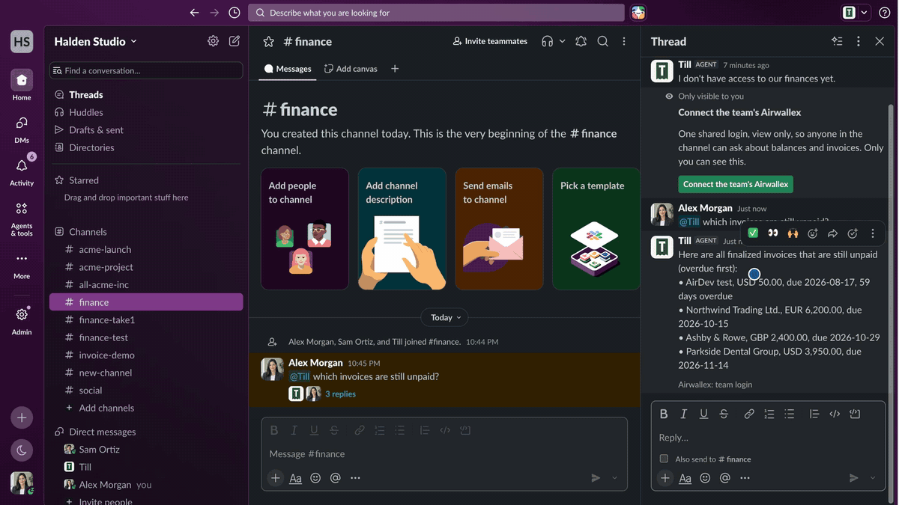

# Till

Till is a finance agent in Slack. Mention `@Till` in a channel to ask about balances or unpaid
invoices. Ask it for an invoice and a finance admin approves it with one click.

Till reads and writes through the Airwallex MCP server. [Vercel Connect](https://vercel.com/docs/connect)
holds every login, to Slack and to Airwallex, so the project has no API keys or tokens of its own.



```
#finance
  Sam   @Till which invoices are overdue?
  Till  • Northwind Trading Ltd., EUR 6,200.00, due 2026-10-15, 1 day overdue
        Airwallex: team login

  Sam   @Till invoice Parkside Dental 3,950 USD for the website redesign, net 30
  Till  I can't create invoices with the team login. That needs a finance admin to sign in. I've asked @Alex.

  Alex  @Till go ahead
  Till  [Invoice Parkside Dental Group]  Website redesign · USD 3,950.00 · Net 30
        Requested by Sam. This will be created with Alex's Airwallex login.
        (Approve) (Cancel)          <- only Alex sees these buttons
  Till  Created invoice INV-0042 for Parkside Dental Group. Open invoice
```

## Who can do what

| Who asks | Airwallex login Till uses | What Till can do |
| --- | --- | --- |
| Anyone in the channel | One shared team login, view only | Answer questions with read-only tools |
| A finance admin | The admin's own login, connected the first time they ask | Create one invoice, after the admin presses Approve |

Airwallex enforces the first limit. The team login is granted only view scopes, so Airwallex refuses
any write it attempts. Admin logins add the billing edit scopes and nothing else.

Till's code narrows the tools again (`lib/airwallex/tool-policy.ts`). With the team login, the model
sees only tools that Airwallex marks read-only. When it creates an invoice, it sees four tools: create
a product, create an invoice, add line items, finalize. Tools that move money (transfers, payouts,
conversions, simulations) are never loaded for any login.

Creating an invoice goes through these checks:

1. Before it asks for approval, Till's code, not the model, finds the Airwallex client. An exact name
   wins. Otherwise the name must be the start of exactly one client's name ("Parkside Dental" finds
   "Parkside Dental Group"). If no client or several clients match, Till stops and says so. The
   approval card shows the client's full name as it appears in Airwallex.
2. Only the admin named on the approval card sees its buttons, and the server checks who clicked and
   in which thread before it acts.
3. The model builds the invoice for the client on the card. The Airwallex `request_id` comes from
   the approval card, so a repeated click cannot create a second invoice.
4. Till reads the invoice back from Airwallex and compares the client, currency, amount and status
   with what was approved. If anything differs, Till voids the invoice.

When an admin signs in to Airwallex for the first time, the link back to Till is a short-lived token
signed by [Vercel KMS](https://vercel.com/docs/kms). The signing key never leaves Vercel, so the link
cannot be forged, and it expires after 15 minutes.

To take someone's access away, remove them from `TILL_FINANCE_ADMIN_SLACK_IDS` or revoke their grant
in Vercel Connect.

## Before you invite Till to a channel

The team login is shared. Anyone who can mention Till in a channel can read everything that login
can see: balances in every currency, every client, and every invoice with its amount and due date.
Till posts its answers in the thread, so everyone in the channel can read them, not only the person
who asked.

Treat a channel with Till in it like a shared view of your Airwallex account:

- Invite Till only to private channels whose members may see company finances.
- Set `TILL_ALLOWED_CHANNEL_IDS` to those channels. Till then ignores mentions anywhere else, even in
  a channel someone invites it to later.
- Check the channel for guests and Slack Connect members from other companies. They can ask Till
  questions too.
- Remember that Slack keeps Till's answers. People who join the channel later can scroll back and read
  them, and exports and search include them.
- Grant the team login only the view scopes in `lib/airwallex/tool-policy.ts`. Remove a scope there,
  for example balances, if the channel should not see that data.
- Keep `TILL_FINANCE_ADMIN_SLACK_IDS` short. Each admin can create invoices with their own login.
- To cut off access quickly, revoke the team login's grant in Vercel Connect. Till then answers that
  it has no access until an admin connects it again.

To report a security problem in Till, see [SECURITY.md](SECURITY.md).

## Code tour

```
app/api/webhooks/slack/       Slack events and button clicks, verified by Vercel Connect
app/api/airwallex/connected/  The page the Airwallex sign-in returns to

lib/slack/        The conversation
  bot.ts            Answer, hand off, ask for approval, create
  cards.tsx         Replies, approval cards and sign-in buttons
  events.ts         Drops Slack's duplicate deliveries
  text.ts           Keeps names and model output from acting as Slack markup

lib/agent/        The model
  jobs.ts           Its two jobs: answer a thread, create one invoice
  instructions.ts   What it is told

lib/airwallex/    Access to Airwallex
  logins.ts         Whose login each job uses
  tool-policy.ts    Scopes and the tools the model may see
  session.ts        Opens the MCP server for one login
  login-link.ts     Signs and verifies the sign-in return link

lib/invoices/     The invoice itself
  request.ts        What an invoice request may contain, validated wherever it comes back in
  customer-match.ts Picks the one client an invoice is for
  check.ts          Reads the created invoice back and voids a mismatch

lib/config.ts     Every setting, validated at startup
lib/copy.ts       Every sentence Till says
lib/log.ts        One JSON line per log entry
```

Till keeps no database. A pending invoice travels inside the Slack buttons and the signed link, and
Till validates it again each time it comes back.

## Set it up

You need a Vercel team with Vercel Connect and Vercel KMS, a Slack workspace where you can install
apps, and an Airwallex sandbox account.

1. Deploy this repository to Vercel as a new project. It needs Node 22 or later.
2. In the project, open Connect and add a Slack connector named `slack/till`. Install it in your
   workspace and invite `@Till` to a channel.
3. Add an MCP connector for `https://mcp.sandbox.airwallex.com/developer` named
   `airwallex/till-sandbox`.
4. In Team Settings, open Key Management. Create an ES256 issuer, add a grant for this project and
   copy the issuer ID.
5. Set the two required environment variables, `TILL_KMS_ISSUER_ID` and
   `TILL_FINANCE_ADMIN_SLACK_IDS`, then redeploy. `.env.example` lists them with the optional ones.
6. Mention `@Till` in the channel. The first time, a finance admin gets a private button to connect
   the shared team login.

To fill an empty sandbox with three example clients and unpaid invoices, run `npm run seed`.

All settings live in `lib/config.ts`. The server checks them when it starts and refuses to run if a
required one is missing or invalid. None of them are secrets.

## Develop

```bash
npm install
vercel link
vercel env pull .env.local   # the OIDC token Vercel Connect needs, plus your settings
npm run dev
```

| Command | What it does |
| --- | --- |
| `npm run check` | Type check, lint, and tests with coverage |
| `npm run check-logins` | Lists which Airwallex logins are connected. It never prints tokens. |
| `npm run seed` | Adds example clients and invoices to an Airwallex sandbox |

Vercel Connect saves logins per environment. `check-logins` reports on the environment your
`.env.local` came from. Run `vercel env pull --environment production` to check production.

## Limits

- Till is built for an Airwallex sandbox. Review the scopes and the tool list before you point it at
  a live account.
- Till keeps no state between requests. It drops Slack's duplicate deliveries by message type, not by
  a stored ID. Add a state adapter such as Redis before you run several instances.
- The invoice check covers client, currency, amount and status. It does not check line items or the
  due date.
- Client lookup reads the first 100 Airwallex clients. With more than that, Till accepts only a
  client's full name, because a partial name could match the wrong client.
- Answers come from a model and can be wrong. Read the approval card before you press Approve.

## License

Apache License 2.0. If you use or adapt this code, keep the [NOTICE](NOTICE) file, which credits
Cyrus David Pastelero, as the license requires. See [LICENSE](LICENSE).
